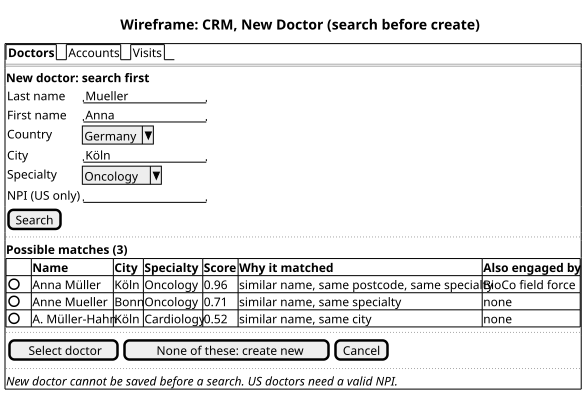
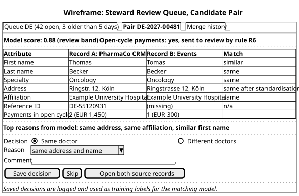

# Wireframes

> Low-fidelity wireframes for the two screens where the requirements meet users. They show content and behaviour, not visual design.
> Sources: [CRM search](../04_models/src/wireframe_search_before_create.puml), [steward review](../04_models/src/wireframe_steward_review.puml) (PlantUML Salt). Fictional data.

## 1. CRM: new doctor, search before create

| Element | Requirement | Note |
|---|---|---|
| Search form before the create form | BR-04, US-01 AC 1 | "None of these" is the only way to the create form |
| Score and "Why it matched" | DEC-09, US-01 | Plain reasons, no model jargon |
| "Also engaged by" column | BR-12, US-13 | Prevents two field forces visiting the same doctor |
| NPI field marked "US only" | BR-03, US-03 | Mandatory and validated when country is US |
| Footer rule text | US-02 AC 3 | Tells the rep why save may be blocked |

**Decided with Country Commercial Leads:** maximum 10 candidates, same NPI first; more than 10 means the rep should refine the search.

## 2. Steward review: candidate pair

| Element | Requirement | Note |
|---|---|---|
| Queue size and age in the tab | BR-14, US-09 | Steward sees backlog without opening a report |
| Model score and band | BR-06, US-07 AC 2 | Shows why the pair is here |
| "Sent to review by rule R6" | BR-07 | Explains why a high score was not auto-merged |
| Side-by-side attributes with match column | BR-08, US-07 AC 1 | Matching and differing values visible at once |
| Payments in open cycle | BR-07, BR-13 | Steward knows the decision affects a report in progress |
| Mandatory reason | US-07 AC 3 | A decision without a reason cannot be saved |
| Footer: decisions become labels | DEC-08, US-07 AC 4 | Steward knows their work trains the model |
