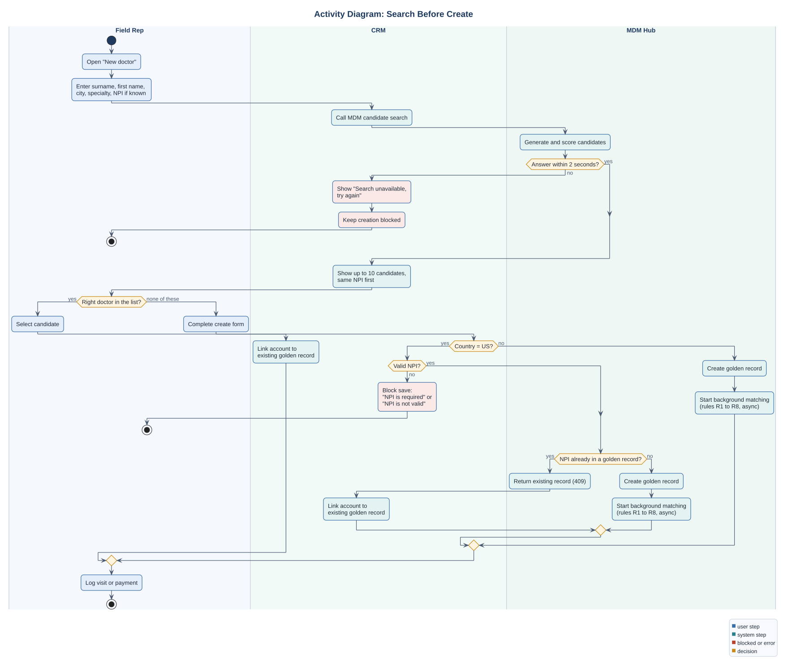

# Activity Diagram: Search Before Create (UML)

> The rep's flow when they meet a doctor who may not be in their CRM, with swimlanes for the rep, the CRM and the MDM hub.
> Implements BR-03, BR-04 and stories [US-01 to US-03](../03_requirements/user_stories.md). Decision: DEC-05. Use case: [UC-02](use_cases.md#uc-02-create-new-doctor).
> Source: [activity_search_before_create.puml](src/activity_search_before_create.puml). Fictional case.

## Business rules on this flow

| # | Rule | Source |
|---|---|---|
| 1 | A new doctor cannot be saved without a search in the same session | US-02, AC 3 |
| 2 | If search is down, creation stays blocked; the rep can log the visit against a "pending doctor" note and finish later | NFR-06, agreed with Country Commercial Leads |
| 3 | Same NPI always links, never creates | BR-03 |
| 4 | Matching after save runs in the background so the rep is not kept waiting | NFR-04 |

## Design choice: why block instead of warn

A warning ("this doctor may already exist") is faster for the rep, but field teams learn to click through warnings. Blocking the save until a search was made adds a few seconds and removes the main source of new duplicates (root cause layer 2). The cost was accepted by Country Commercial Leads on the condition that search answers within 2 seconds (NFR-04).

The screen behind this flow: [wireframe](../03_requirements/wireframes.md#1-crm-new-doctor-search-before-create).
