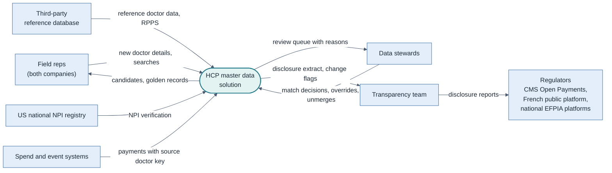
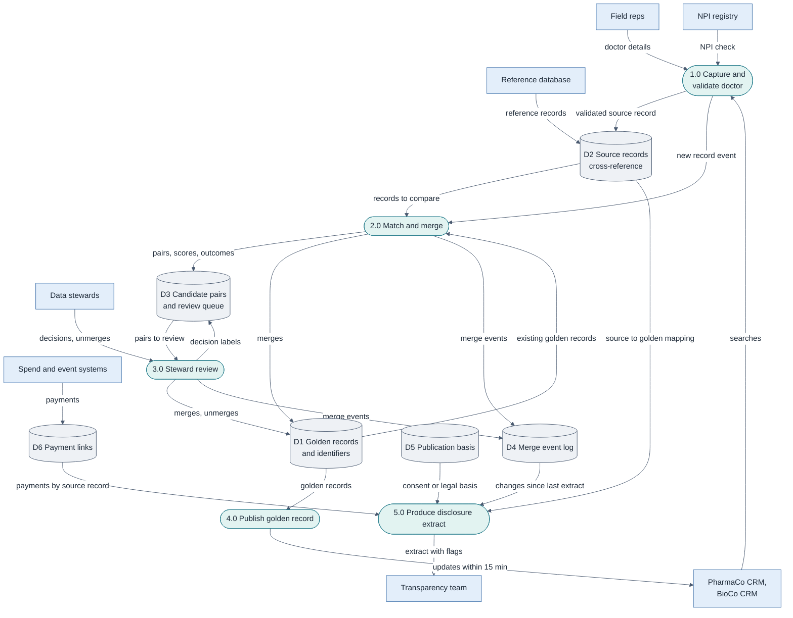

# Data Flow Diagrams

> Where HCP data comes from, where it is stored and where it goes. DFD notation adapted to Mermaid: rectangles = external entities, rounded boxes = processes, cylinders = data stores.
> Fictional case.

## 1. Context diagram (level 0)

The solution never sends data to regulators directly. The Transparency team stays responsible for what is published.

## 2. Level 1

## 3. Data stores

| Store | Content | Owner | Retention |
|---|---|---|---|
| D1 Golden records and identifiers | One record per doctor, NPI, RPPS, reference ID | Data Governance Lead | While the doctor is in scope, plus legal retention |
| D2 Source records cross-reference | Every source record and its golden record | Data Governance Lead | As D1 |
| D3 Candidate pairs and review queue | Pairs, scores, outcomes, steward decisions | Data Governance Lead | Used as training labels; retention agreed with DPO (NFR-05) |
| D4 Merge event log | Immutable history of merges and unmerges | Chief Compliance Officer | At least as long as disclosure records must be kept |
| D5 Publication basis | Consent or legal basis per doctor, country, year | Chief Compliance Officer | As disclosure records |
| D6 Payment links | Link between each payment and its source record | Transparency Analyst | As disclosure records |

## 4. Personal data note

D1, D2, D3 and D5 hold personal data of doctors. Access follows NFR-02. Model training reads D2 and D3 only within the purpose agreed with the DPO (NFR-05).
