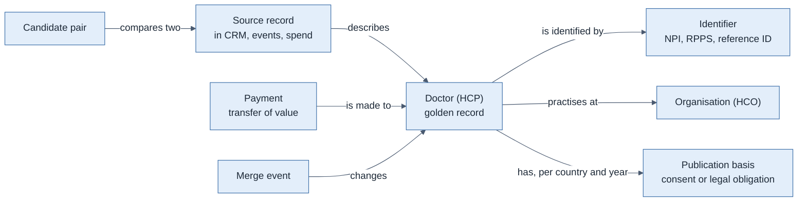
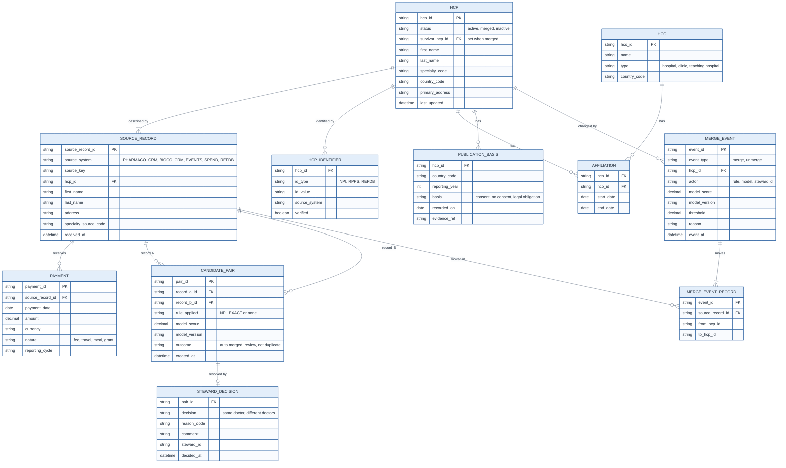
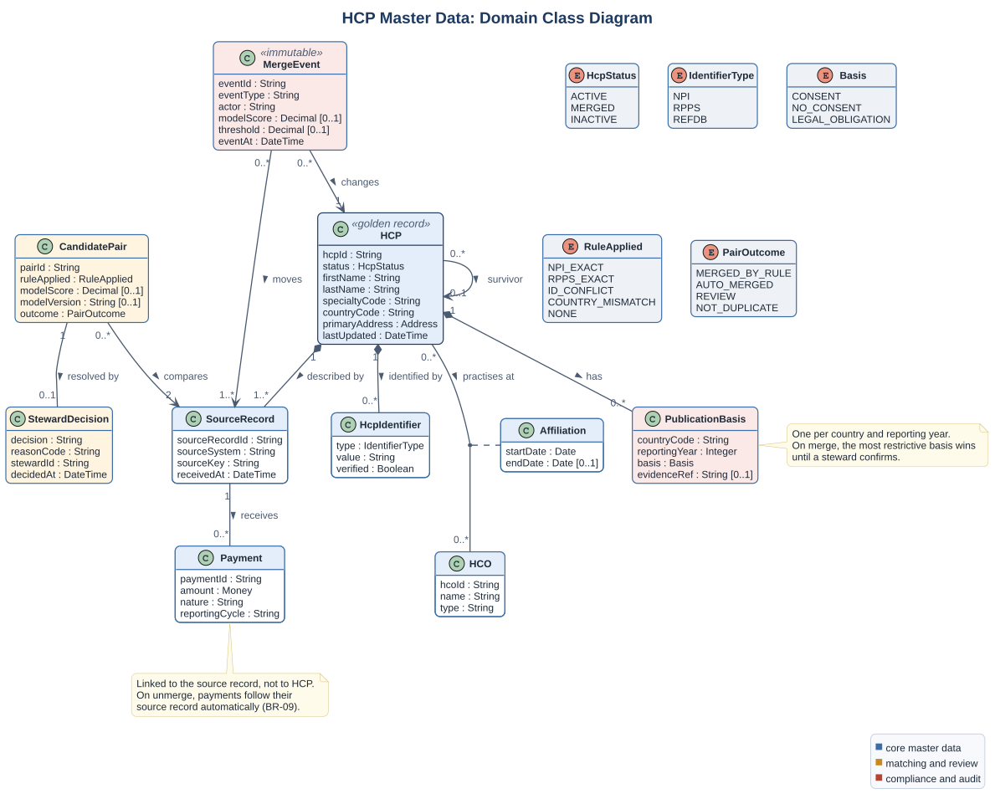

# Data Model: HCP Master Data

> Conceptual and logical model for the HCP master. Attribute-level detail: [data dictionary](data_dictionary.md).
> The model is vendor-neutral: an MDM platform implements it as configuration.
> Fictional case.

## 1. Conceptual model

What the business talks about, in its own words.

**Key business rules shown by the model**

- A doctor has **one** golden record and **one or more** source records.
- A payment is linked to a source record in the system that made it, and through it to exactly one golden record (BR-02).
- Publication basis is held **per country and reporting year**: the same doctor can consent in one year and withdraw in the next.
- Merge events are never deleted (NFR-01).

## 2. Logical model

## 3. UML class diagram

The same domain in UML notation, with multiplicities, composition, the affiliation association class and enumerations.
Source: [class_domain.puml](src/class_domain.puml).

Lifecycles of HCP and candidate pair: [state machines](state_machines.md).

## 4. Design decisions in the model

| Decision | Why | Alternative rejected |
|---|---|---|
| **Payments link to the source record, not directly to the golden record** | When a merge is undone, payments follow their source record to the correct doctor automatically (BR-09) | Linking payments to the golden record would need a manual re-assignment on every unmerge |
| **Merged golden records are kept with status `merged` and a pointer to the survivor** | A system that still holds the old ID can be redirected; history stays readable | Deleting merged records would break references in both CRMs |
| **Identifiers in a separate entity** | A doctor can have NPI, RPPS and a reference ID at the same time, each with its own source and verification | Columns per identifier type would need a schema change for every new country |
| **Publication basis per country and year** | Consent can change by year; France has a legal basis instead of consent (BR-10) | One consent flag on the doctor cannot express either |
| **Merge event plus moved records** | Unmerge needs to know exactly which source records moved where (NFR-01) | A single "merged with" field loses the history after a second merge |
| **Candidate pairs are stored, including "not duplicate"** | They become training labels and explain past decisions (DEC-08) | Storing only merges gives no negative examples, the problem we found in discovery |

## 5. What the model leaves out on purpose

- Full HCO hierarchy (parent organisations, networks): out of scope (DEC-01).
- Patient data: never part of HCP master data.
- Contact details used only for marketing: not needed for matching or reporting (NFR-05).
