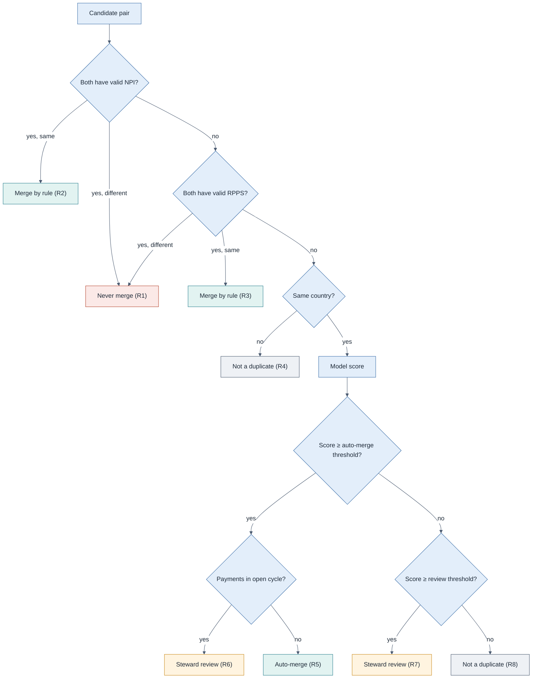

# Matching and Survivorship Rules

> How candidate pairs are decided and which values win on the golden record.
> Business basis: [BRD](../03_requirements/BRD.md) BR-03, BR-06, BR-07, BR-09, BR-10; decisions DEC-03, DEC-05 to DEC-07.
> Model details: [ML requirements](../03_requirements/ml_requirements.md).
> Fictional case.

## 1. Order of evaluation

Rules are evaluated **in this order**. The first rule that applies decides the outcome.

| Step | Rule | Outcome | Why first |
|---|---|---|---|
| R1 | Both records have valid NPIs that **differ**, or valid RPPS numbers that **differ** | **Never merge** | Two national identifiers means two people. No score can override this |
| R2 | Both records have the same valid NPI | **Merge by rule** | Exact national identifier |
| R3 | Both records have the same RPPS (France) | **Merge by rule** | Exact national identifier |
| R4 | Different country of practice and no shared identifier | **Not a duplicate** in phase 1 | Cross-border doctors are rare; handled manually on request |
| R5 | Model score ≥ auto-merge threshold | **Auto-merge**, unless R6 applies | See thresholds below |
| R6 | Either record has payments in an **open reporting cycle** | **Steward review**, even after R5 | BR-07: protect reports in progress |
| R7 | Review threshold ≤ model score < auto-merge threshold | **Steward review** | Human decides |
| R8 | Model score < review threshold | **Not a duplicate** | Recorded, not shown to stewards |

**Note on R2, R3 and R6.** A merge by an exact national identifier also touches records that may have open-cycle payments. It still proceeds automatically, because the identifier is certain, but the Transparency team is notified so that the report in progress reflects it.

## 2. Thresholds

| Threshold | Initial value | Set by | Basis |
|---|---|---|---|
| Auto-merge | Calibrated so that precision ≥ 99.9% on the held-out set, per country | CCO | DEC-07 |
| Review | Calibrated so that auto + review recall ≥ 95%, within steward capacity | Data Owner, Data Governance Lead | ML requirements 5.1 |

Values are numbers between 0 and 1 set during model validation in phase 0. Any change goes through change control ([RACI](../05_governance/raci.md)) and is logged with its effective date, because every automatic merge records the threshold in force.

## 3. Two matching modes

| | Initial load (BioCo) | Steady state (field entry) |
|---|---|---|
| Trigger | One-off batch | Every new or changed record |
| Before matching | Dry run with counts per outcome | Search before create in the CRM |
| Rules | R1 to R8 | R1 to R8 |
| Review | Peak volume, temporary extra stewards | Daily queue per country |
| Safety net | Sampled audit of 1,000 automatic merges before the real load; rollback within 30 days | Monthly sampled audit; unmerge |

## 4. Survivorship: which value wins

When source records disagree, the golden record takes the value defined below.

| Attribute | Rule | Why |
|---|---|---|
| NPI | Verified value from the national registry; if not yet verified, BioCo CRM | BioCo enforces NPI at entry (DEC-03) |
| RPPS | Reference database | Maintained from the national register |
| First and last name | Reference database; else most recent CRM value | Reference data is curated; CRMs are typed in the field |
| Specialty | Reference database; else most frequent mapped value across sources | Field users often pick a generic specialty |
| Address of practice | Most recent value from a source flagged as verified | Doctors move; old addresses cause false matches |
| Affiliations | Union of all current affiliations, each with its own dates | A doctor can practise in more than one place |
| Publication basis | **Most restrictive wins**: `no consent` over `consent`, until a steward confirms | Publishing without consent is a breach; publishing in aggregate is not |
| Payments | Never merged: each payment stays linked to its source record | Unmerge must move payments back correctly (BR-09) |

**Manual override.** A steward can set a value by hand. The override is logged, wins over the rules, and stays until the steward removes it or a verified registry value changes.

## 5. Unmerge

1. The steward selects the source records that belong to a different doctor.
2. A new golden record is created for them; identifiers and affiliations from those records move with them.
3. Payments linked to the moved source records now roll up to the new golden record (data model, section 4).
4. Survivorship is recalculated for both golden records.
5. The pair is stored as a "different doctors" label, so the model learns from the mistake.
6. If payments in an open reporting cycle are affected, the Transparency team is notified (US-08).

## 6. Real-world parallel

The same rule types worked in the author's travel-tech experience with bus stops (see [README](../README.md#real-world-parallel)): written naming rules, one team allowed to create stops, a fixed order of checks before a new stop could exist. What is new here is the model score for fuzzy cases and the legal weight of a wrong merge.
