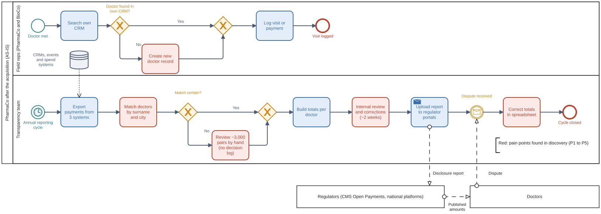
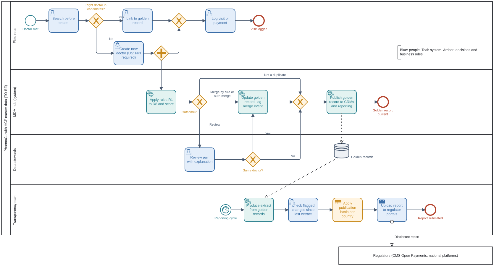

# Processes: AS-IS and TO-BE (BPMN 2.0)

> Process models in BPMN 2.0 notation: pools, lanes, events, gateways, message flows, data stores.
> Source files open in Camunda Modeler or [demo.bpmn.io](https://demo.bpmn.io): [as_is.bpmn](src/as_is.bpmn), [to_be.bpmn](src/to_be.bpmn).
> AS-IS is based on the observation of the annual reconciliation and the interviews ([interview summaries](../01_discovery/interview_summaries.md)).
> Fictional case.

## 1. AS-IS: annual disclosure reconciliation

**How to read it**

- Two unrelated flows in one company. Reps create doctors in their own CRM all year (top lane). Once a year the Transparency team tries to reconcile everything (bottom lane, timer start event).
- The only link between them is the data store: whatever reps typed is what the Transparency team exports.
- The review of doubtful pairs is a manual task with **no decision log**, so the next cycle starts from zero.
- Disputes arrive as messages from doctors **after** publication and are corrected in a spreadsheet, not at the source.

### Pain points

| # | Where | Problem | Root cause layer |
|---|---|---|---|
| P1 | Rep creates a record | Each CRM checks only itself; no shared ID | 1, 2 |
| P2 | Matching by surname and city | Spelling variants split one doctor; namesakes are merged | 1 |
| P3 | Manual review | ~3,000 pairs per cycle, decisions not recorded | 3 |
| P4 | Once a year | Errors made in January are found the next spring | 2, 3 |
| P5 | Disputes | Corrections go back to spreadsheets, not to the source | 3 |

## 2. TO-BE: continuous matching at entry

**How to read it**

- **Reps** search before they create. If they must create, a parallel gateway lets them log the visit at once while the MDM hub matches the new record in the background.
- **MDM hub** (service tasks) applies rules R1 to R8 and routes each pair: merge, not a duplicate, or review.
- **Stewards** decide only the review band. "Same doctor" goes back to the merge task; "different doctors" goes straight to publishing.
- **Transparency team** produces the extract from golden records, checks changes flagged since the last extract and applies publication basis per country (business rule task).
- The golden records data store links daily matching with yearly reporting.

### What changes

| AS-IS pain | TO-BE answer | Requirement |
|---|---|---|
| P1 | Search before create across golden records; NPI required in the US | BR-03, BR-04 |
| P2 | Rules for exact identifiers, model for fuzzy cases, R1 stops namesakes with different NPIs | BR-06, BR-07 |
| P3 | Steward queue with reasons; decisions stored and reused as labels | BR-08 |
| P4 | Matching runs on every new record, not once a year | BR-01, BR-06 |
| P5 | Disputes are corrected in the master and flagged in the next extract | BR-09, BR-13 |

**Expected effect:** the yearly cycle shrinks from about six weeks to about two, because most matching is already done when the extract is produced (business case, section 7).

## 3. Modelling choices

| Choice | Why |
|---|---|
| Regulators and doctors as collapsed (black-box) pools | Their internal processes are outside our scope; only the messages matter |
| Timer start event for the reporting cycle | The reconciliation is triggered by the calendar, not by an event in the data |
| Parallel gateway after "Create new doctor" | The rep must not wait for matching (NFR-04) |
| Business rule task for publication basis | Logic is table-driven per country and year (BR-10), owned by Compliance |

## 4. Related diagrams

- Rep's search before create, step by step: [activity diagram](activity_search_before_create.md)
- System interactions: [sequence diagrams](sequence_diagrams.md)
- Data stores and flows: [data flow diagrams](data_flows.md)
