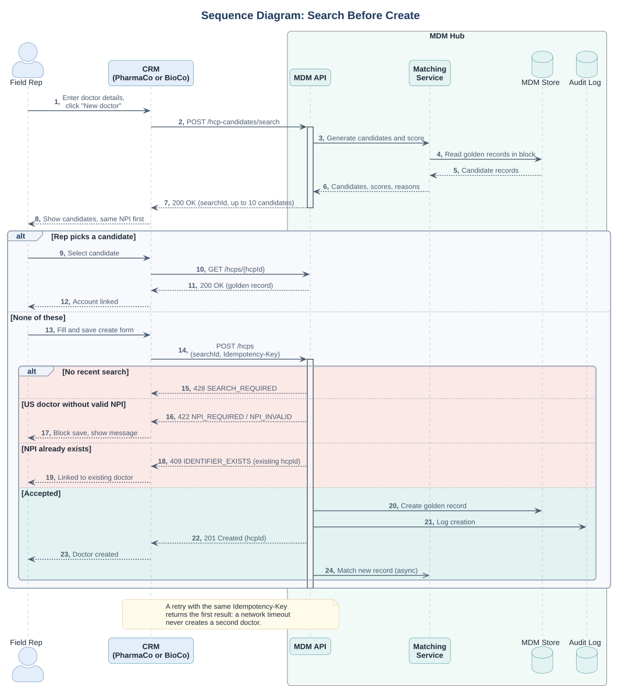
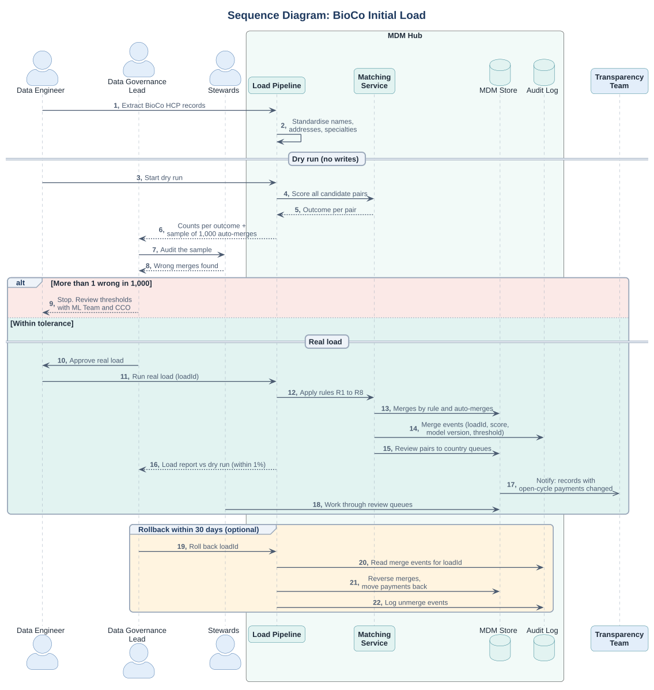

# Sequence Diagrams (UML)

> System interactions for the two matching modes (DEC-05).
> API contract: [mdm_api.yaml](mdm_api.yaml). Rules: [matching rules](matching_rules.md).
> Sources: [search before create](src/sequence_search_before_create.puml), [BioCo load](src/sequence_bioco_load.puml). Fictional case.

## 1. Search before create (steady state)

**Points worth noting**

- `searchId` proves that a search happened before creation (US-02, AC 3). A create request without a recent `searchId` is rejected with `428 Precondition Required`.
- `Idempotency-Key` stops a retry after a network timeout from creating the same doctor twice. A classic source of duplicates in integrations.
- Matching after creation is asynchronous so the rep does not wait (NFR-04).
- Each business rule has its own status code, so the CRM can show the right message: 422 for NPI, 409 for an existing identifier, 428 for a missing search.

## 2. BioCo initial load (batch)

**Points worth noting**

- The dry run writes nothing; it only produces counts and a sample for audit (US-04).
- Every merge carries the load ID, so a rollback touches only this load.
- The Transparency team is told about changes to records with open-cycle payments, because a report may already be in progress.
