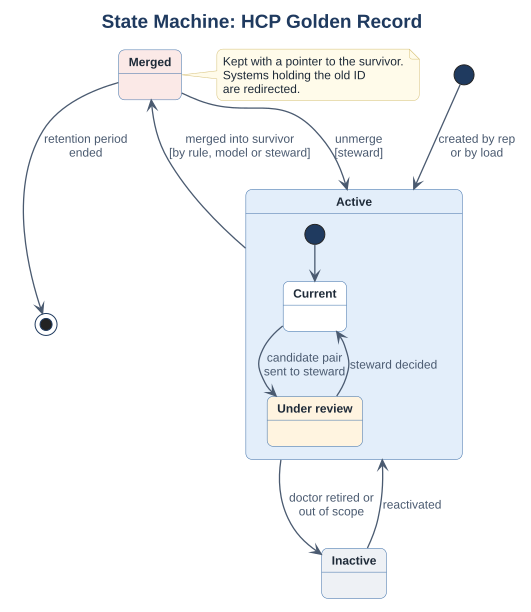
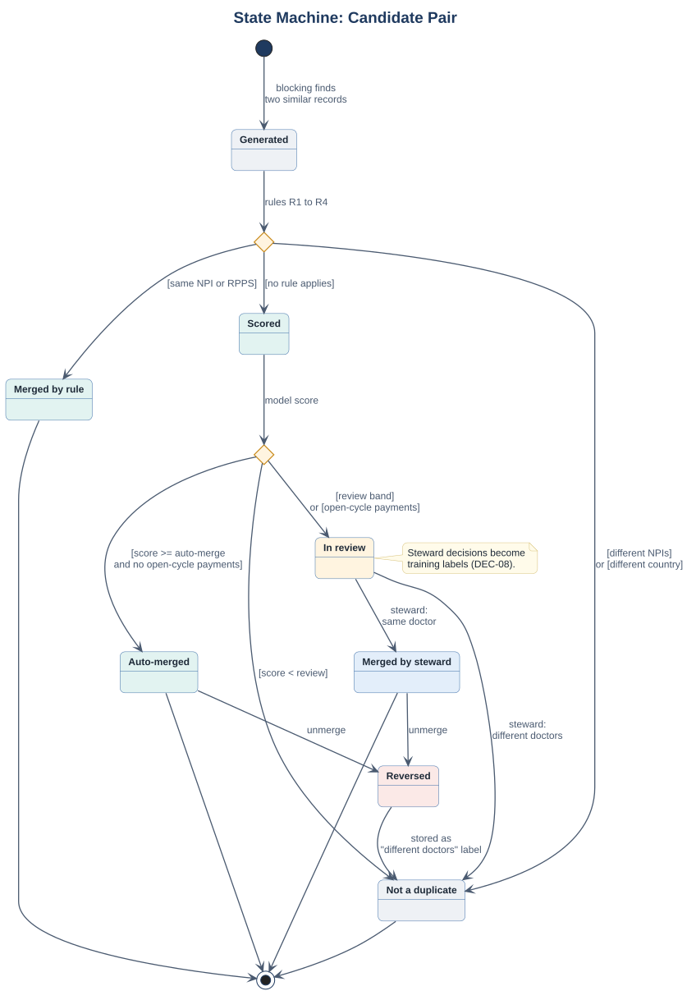

# State Machines (UML)

> Lifecycles of the two objects whose state drives the business rules.
> Sources: [state_hcp.puml](src/state_hcp.puml), [state_candidate_pair.puml](src/state_candidate_pair.puml). Fictional case.

## 1. HCP golden record

| State | Meaning | Who can change it |
|---|---|---|
| Active / Current | The doctor's trusted record, published to CRMs and reporting | System on create; steward |
| Active / Under review | A candidate pair with this record waits for a steward | System (rule R6 or review band) |
| Merged | Merged into a survivor record; kept with a pointer so old IDs can be redirected | Rule, model or steward |
| Inactive | Doctor retired or out of scope; kept for reporting history | Steward |

**Why it matters:** a merged record is never deleted (data model, section 4). Systems that still hold the old ID are redirected by the API (`status: MERGED`, `survivorHcpId`).

## 2. Candidate pair

| Transition | Guard | Requirement |
|---|---|---|
| Generated → Not duplicate | Different valid NPIs or RPPS numbers, or different country without a shared identifier | R1, R4 |
| Generated → Merged by rule | Same NPI or RPPS | R2, R3 |
| Scored → Auto-merged | Score ≥ auto-merge threshold **and** no open-cycle payments | R5, BR-07 |
| Scored → In review | Review band, **or** open-cycle payments | R6, R7 |
| Auto-merged / Merged by steward → Reversed | Steward unmerges | BR-09 |
| Reversed → Not duplicate | Always; stored as a "different doctors" label | DEC-08 |

**Why it matters:** the "Reversed" state turns every mistake into a training example, so the model learns from exactly the cases it got wrong.
