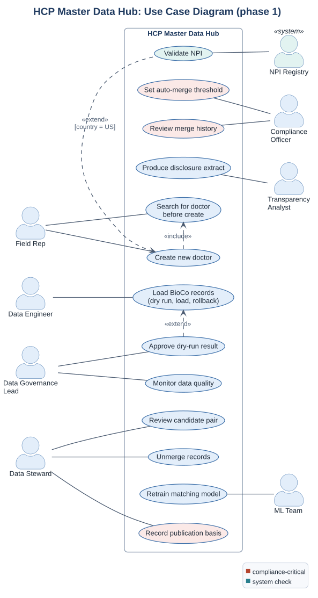

# Use Cases (UML)

> Who uses the HCP master data hub and for what, in phase 1.
> Two use cases are specified in full below; the others are covered by [user stories](../03_requirements/user_stories.md).
> Fictional case.

## Use case list

| ID | Use case | Primary actor | Stories | Requirements |
|---|---|---|---|---|
| UC-01 | Search for doctor before create | Field Rep | US-01 | BR-04, NFR-04 |
| UC-02 | Create new doctor | Field Rep | US-02, US-03 | BR-03, BR-04 |
| UC-03 | Validate NPI (extends UC-02 for US) | NPI Registry (secondary) | US-03 | BR-03 |
| UC-04 | Load BioCo records | Data Engineer | US-04 | BR-05 |
| UC-05 | Approve dry-run result (extends UC-04) | Data Governance Lead | US-04 | BR-05, BR-07 |
| UC-06 | Monitor data quality | Data Governance Lead | US-09, US-14 | BR-14, BR-16 |
| UC-07 | Review candidate pair | Data Steward | US-07 | BR-08 |
| UC-08 | Unmerge records | Data Steward | US-08 | BR-09 |
| UC-09 | Record publication basis | Data Steward, Compliance Officer | US-11 | BR-10 |
| UC-10 | Set auto-merge threshold | Compliance Officer | n/a | BR-07, DEC-07 |
| UC-11 | Review merge history | Compliance Officer | US-06, US-12 | NFR-01, BR-13 |
| UC-12 | Produce disclosure extract | Transparency Analyst | US-10, US-11 | BR-02, BR-13 |
| UC-13 | Retrain matching model | ML Team | n/a | BR-16, DEC-08 |

---

## UC-02. Create new doctor

| | |
|---|---|
| **Primary actor** | Field Rep |
| **Secondary actors** | MDM hub, NPI Registry (US only) |
| **Goal** | Record a doctor who is not yet in the master, without creating a duplicate |
| **Trigger** | The rep meets a doctor and cannot find them in the CRM |
| **Preconditions** | The rep is signed in to the CRM; the rep has run UC-01 in the current session |
| **Postconditions (success)** | A golden record exists for the doctor, the rep's account is linked to it, background matching has started |
| **Postconditions (failure)** | No new record exists; the rep sees why |
| **Requirements** | BR-03, BR-04, NFR-04 · Stories US-01 to US-03 · Activity diagram: [search before create](activity_search_before_create.md) |

**Main success scenario**

1. The rep enters surname, first name, country, city and specialty.
2. The system shows candidate doctors (UC-01).
3. The rep selects "None of these".
4. The system opens the create form with the data already typed.
5. The rep completes and saves the form.
6. The system creates a golden record and links the rep's account to it.
7. The system starts background matching for the new record.
8. The rep logs the visit.

**Alternative flows**

- **3a. The rep finds the right doctor in the candidate list.** The system links the rep's account to the existing golden record. The use case ends; no new doctor is created.
- **5a. Country is US** (extension point, UC-03 Validate NPI):
  1. The system checks that an NPI is present and has a valid check digit.
  2. If the NPI already belongs to a golden record, the system links the rep's account to it and informs the rep. The use case ends.
- **6a. Search was not made in this session.** The system refuses to save and asks the rep to search first.

**Exception flows**

- **2e. Search does not answer within 2 seconds.** The system shows "Search unavailable, try again" and keeps creation blocked.
- **5e. US NPI is missing or invalid.** The system blocks the save with "NPI is required for US doctors" or "NPI is not valid".
- **6e. The same request is sent twice after a timeout.** The system returns the first result; no second doctor is created (Idempotency-Key).

**Business rules:** R1 to R3 in [matching rules](matching_rules.md); "no NPI, no record" for US (DEC-03).

---

## UC-07. Review candidate pair

| | |
|---|---|
| **Primary actor** | Data Steward (central or local) |
| **Goal** | Decide whether two records describe the same doctor, with a reason that can be audited and reused |
| **Trigger** | A pair enters the steward's country queue (review band, or open-cycle payments by rule R6) |
| **Preconditions** | The steward has access to the country queue (NFR-02) |
| **Postconditions (success)** | The pair is resolved; a merge event or a "different doctors" decision is logged; the decision is available as a training label |
| **Requirements** | BR-08, BR-09, NFR-01 · Story US-07 · Wireframe: [steward review](../03_requirements/wireframes.md#2-steward-review-candidate-pair) |

**Main success scenario**

1. The steward opens the next pair in the queue.
2. The system shows both records side by side, the model score, the top contributing attributes and whether either record has open-cycle payments.
3. The steward compares the records and, if needed, opens the source records.
4. The steward selects "Same doctor" and a reason from the fixed list.
5. The system merges the records, recalculates survivorship and logs the merge event with the steward's ID and reason.
6. If open-cycle payments are affected, the system notifies the Transparency team.

**Alternative flows**

- **4a. Different doctors.** The steward selects "Different doctors" and a reason. The system stores the decision; both records stay separate and the pair will not be proposed again unless the records change.
- **4b. Not enough information.** The steward skips the pair; it stays in the queue and counts towards queue age (BR-14).
- **5a. The steward later finds the merge was wrong.** Continue with UC-08 Unmerge records.

**Business rules:** a decision without a reason cannot be saved (US-07, AC 3).
